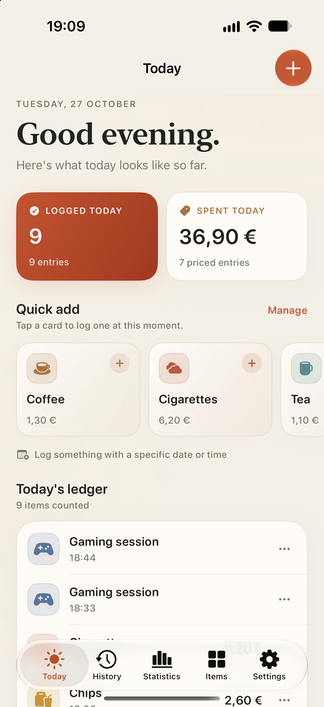
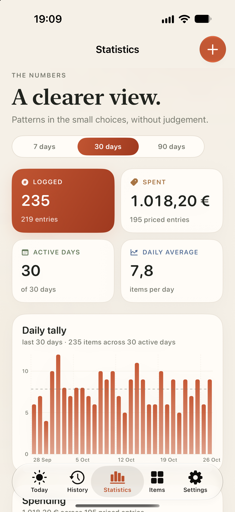
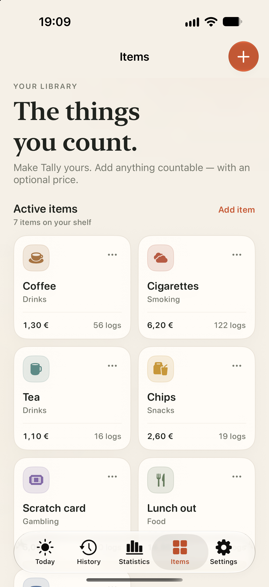
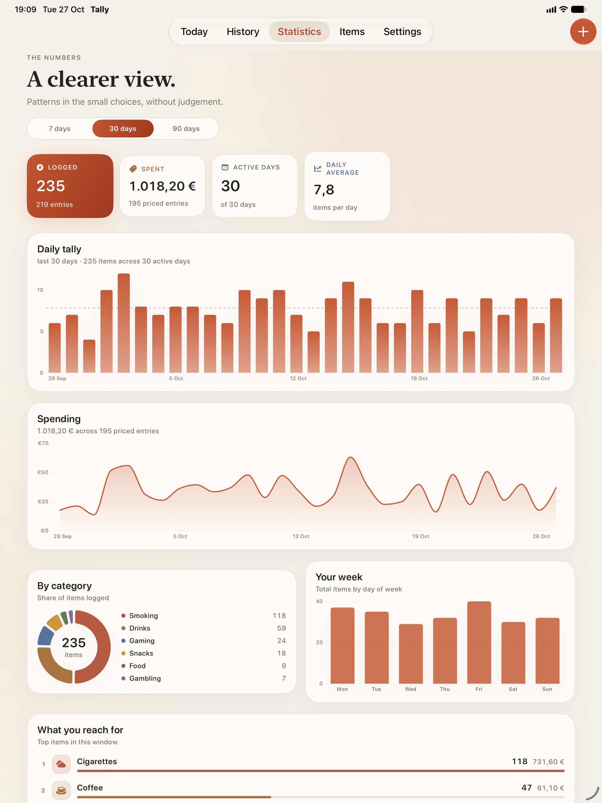
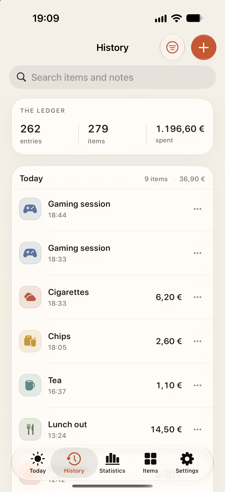
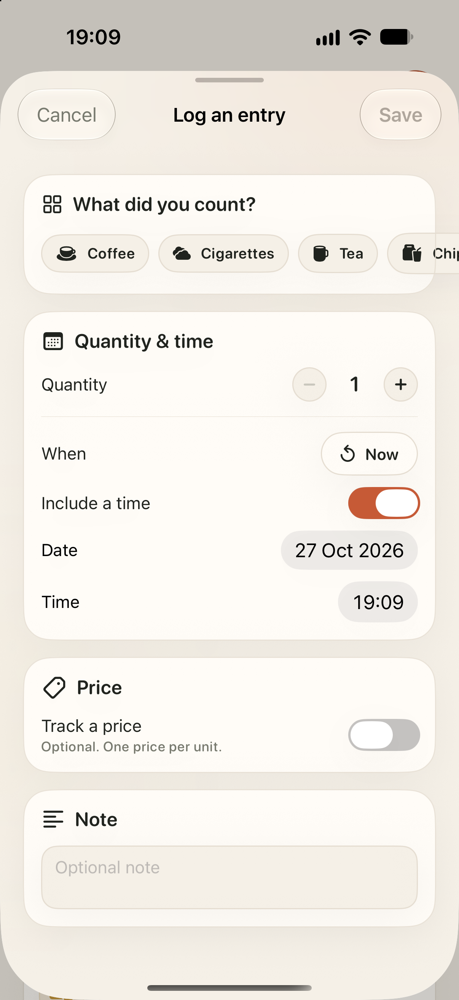
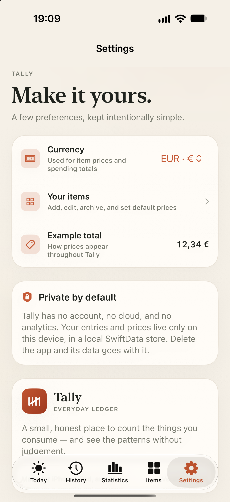
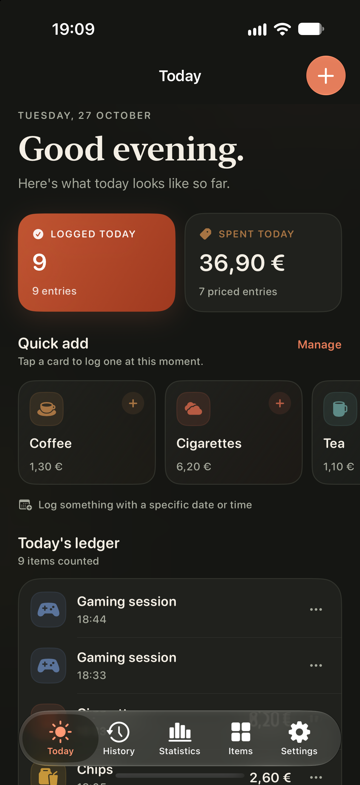
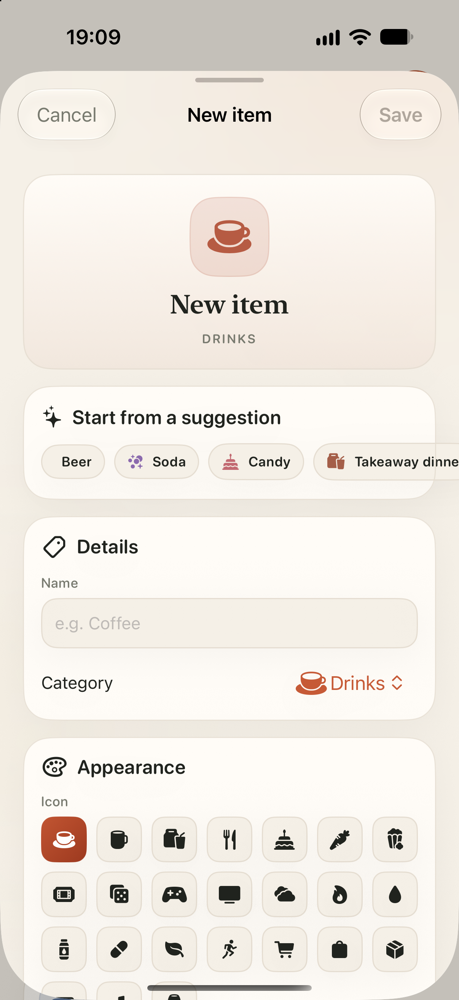
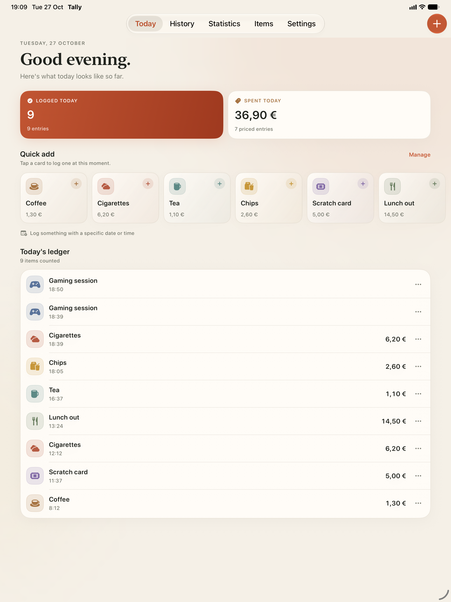

# Tally

**A gentle, local-first ledger for the little things you consume.**

Tally is a native SwiftUI app for iPhone, iPad, and Mac. Tap once to log a coffee, a cigarette, a packet of chips, a scratch ticket, lunch out, or a gaming session. Add entries for any date and time, attach optional prices, edit or delete them later, and watch the patterns emerge in clear, honest charts.

<p align="center">
  
  
  
</p>

<p align="center">
  
</p>

## What's inside

- **One-tap quick add** — a horizontally scrolling shelf of your items, each logging one entry at the current moment.
- **A proper ledger** — entries include item, quantity, optional note, optional price per unit, and an optional time of day.
- **Any date, time optional** — choose a date and either include an hour/minute or mark it as an all-day entry.
- **Editing and deleting** — tap any row to edit it; use the row menu or the editor to delete it.
- **Your own catalog** — create custom items with a name, SF Symbol, color, category, and optional default price.
- **Thoughtful presets** — Coffee, Cigarettes, Tea, Chips, Scratch card, Lunch out, and Gaming session are seeded on first launch. More suggestions (Beer, Soda, Candy, Takeaway dinner, Online purchase, Painkiller) appear while creating a new item.
- **Archive instead of lose** — archive items you no longer count; their history stays, and they can be restored at any time. Permanent deletion is also available with an explicit warning.
- **Statistics that respect the data** — 7-, 30-, and 90-day windows with:
  - items logged, entry count, total spend, active days, and daily average
  - a daily tally chart with an average line
  - a spending trend chart when prices exist
  - an item-category donut
  - a weekday distribution chart
  - a ranked “What you reach for” list with counts and spend
- **Prices are optional** — totals only include entries that have a price. Default prices are copied to new entries, but each entry keeps its own price snapshot, so changing an item later never rewrites the past.
- **Private by default** — no account, no cloud, no analytics. Data lives on-device in SwiftData.
- **One SwiftUI codebase** — adaptive layouts for iPhone, iPad, and Mac, with full light and dark mode support.

## More screens

<p align="center">
  
  
  
</p>

<p align="center">
  
  
  
</p>

> Screenshots use the optional debug sample data. A new install starts with the seven starter items and an empty ledger.

## Requirements

- Xcode 16 or newer (built and tested with Xcode 27.1)
- iOS / iPadOS 17.0+
- macOS 14.0+
- No third-party dependencies

## Run it

1. Open **`Tally.xcodeproj`** in Xcode.
2. Select the **Tally** scheme.
3. Pick **My Mac**, **iPhone 18 Pro** (or any iOS 17+ simulator), or an iPad simulator.
4. Press **Run** (⌘R).

The project is configured for ad-hoc local signing, so it runs without a development team on the simulator and on My Mac. To install on a physical iPhone or iPad, open **Signing & Capabilities**, select your team, and switch to automatic signing.

### Sample data for the simulator

Debug builds understand a few launch arguments, used for the screenshots and handy for exploring the charts:

- `-demoData` — seeds a deterministic 35-day history, once, alongside the starter presets
- `-startTab today|history|stats|items|settings` — opens a specific tab
- `-openAddEntry` — opens the new-entry sheet on launch
- `-openNewItem` — opens the new-item sheet on launch

Set these in **Product → Scheme → Edit Scheme → Run → Arguments**. They are compiled only into `DEBUG` builds.

## Tests

The test target builds and covers the pure statistics engine and price parsing:

- `StatsEngineTests` — totals, price snapping, active days, date-window boundaries, item/category ranking, weekday grouping, empty ranges
- `MoneyTests` — decimal separators, grouping separators, currency-symbol cleanup, invalid input, quantity × price

Run them in Xcode with **Product → Test** (⌘U) on an iOS simulator.

The `StatsEngine` was also validated standalone with an 18-assertion harness while building the app.

## Project layout

```
Tally.xcodeproj          Generated Xcode project
project.yml              XcodeGen project definition (optional regeneration)
Tally/
  App/                   App entry point, root tab/sidebar navigation, router
  Models/                SwiftData models, starter presets, stats engine
  Views/
    Today/               Quick add, daily summary, today's ledger
    History/             Searchable, filterable day-grouped history
    Stats/               Charts and metric dashboard
    Entries/             Entry editor, row, quick-add tile
    Items/               Item library and item editor
    Settings/            Currency, privacy, about
  Design/                Theme, buttons, cards, shared components
  Support/               Money/date formatting, color helpers
  Assets.xcassets/       Adaptive colors and app icon
TallyTests/              Stats engine and money tests
Screenshots/             Final app screenshots
```

## Design and implementation notes

- **SwiftData is the source of truth.** `Consumable` and `ConsumptionEntry` are `@Model` classes with a cascade relationship. Entries are never duplicated into statistics storage.
- **Money is stored in minor units.** `Int` cents avoid floating-point drift. `Money` handles parsing and localized currency display.
- **Statistics are pure.** `StatsEngine` receives lightweight `ConsumptionRecord` snapshots, not views or model contexts, which keeps it testable. The view layer converts SwiftData entries to records.
- **Optional time is explicit.** Each entry has a `hasTime` flag. When it is off, the entry is normalized to the start of the day and shown as “All day”.
- **Charts use Apple's Swift Charts.** No charting library or web view is involved.
- **The UI is intentionally compact.** Today, the ledger, quick-add, and stats are all one tap away; the floating tab bar on newer iOS versions sits over scrolling content by design.

## Scope

Tally is deliberately a small, local ledger. It does not include sync, accounts, CSV export, notifications, or widgets. Archived items keep their history; deleting an item and its entries is available with a warning.
